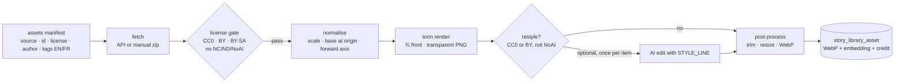
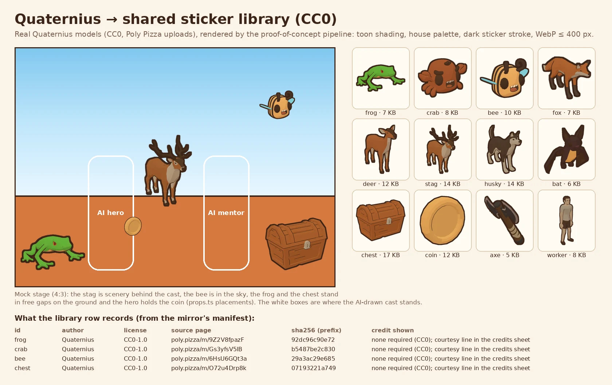
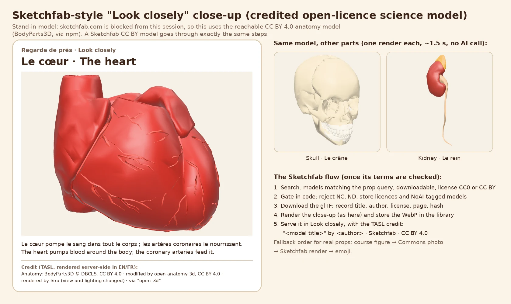
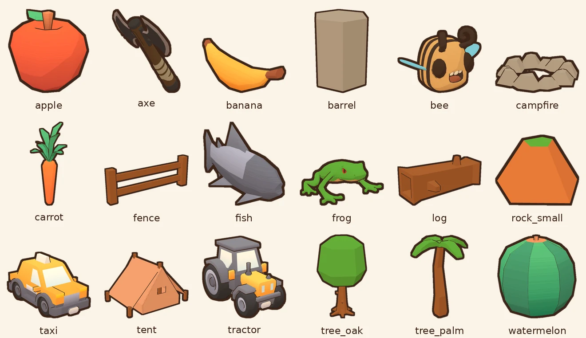

# Story mode × free 3D assets: review and integration plan

**Date:** 2026-11-18
**Scope:** how Poly Haven, Sketchfab, BlenderKit, Quaternius and ambientCG could supply part of story mode's visuals, combined with AI images, so the AI does not have to draw everything.
**Related:** #2672 (story epic), #2675 (cast and backdrop art), #2681 (props, phase 1), #2683 (real photos, phase 2), #2684 (AI stickers, phase 3).

> ⚠ **The license facts below were not checked live.** This session's network policy blocks polyhaven.com, ambientcg.com, sketchfab.com, blenderkit.com and quaternius.com, so every license and API point comes from prior knowledge (up to mid-2026). Items marked **⚠ verify** must be confirmed on each site's license and API pages before anything is built.
>
> **Update (same day):** the usual alternatives are blocked too (Kenney, Poly Pizza, OpenGameArt, Wikimedia, Smithsonian, NIH 3D). Only GitHub, npm and PyPI are reachable. Real Quaternius and Kenney CC0 models, and a CC BY 4.0 anatomy model, were found mirrored on npm and used for a working proof of concept. See §11.

---

## 1. Summary

1. **Keep the AI for people.** The cast (West African faces, skin tones, outfits) and their four poses are where image generation adds the most, and no free library has them. Generic 3D characters would be a step backwards.
2. **Use 3D for objects and structure, which the AI is worst at keeping consistent.** The three places where 3D gives the most value:
   - **A shared library of prop stickers** (Quaternius, plus Poly Haven models), rendered once in the house cartoon style and reused by every course. It becomes the first step of #2684, before any paid AI sticker.
   - **Educational close-ups** ("Look closely") from Sketchfab models that carry an allowed license (microscope, snail, skeleton, rocks, instruments). A render of a real model is accurate where an AI drawing may invent parts.
   - **Backdrop blockouts:** a simple 3D set per place theme with a fixed camera, horizon and an open floor band, which the AI then paints over in the house style. Each backdrop still costs one AI call, but the composition becomes predictable.
3. **Use ambientCG and Poly Haven only as supporting material:** textures (laterite ground, mud brick, corrugated iron) and HDRI lighting for those renders.
4. **Keep BlenderKit out of the automated pipeline.** It is built around a Blender add-on, most assets are under a royalty-free license that forbids passing the files on, and its AI terms are unclear (⚠ verify). At most, an artist can use it by hand.
5. **Never ship 3D at runtime.** A WebGL viewer would break the <150 KB JS budget and the 2G/3G target. Learners get only pre-rendered WebP stills, exactly like today's art.

---

## 2. What story mode draws today

| Stage element | Today | Image calls | Pain points |
|---|---|---|---|
| Cast (hero variants and the other characters) | AI: `idle` generated, then `talk`, `happy`, `think` as **edits** of idle (`story_art_service.py`) | ~24 per course, the slowest calls (edit timeout 210 s) | Refusals, drift between poses |
| Places | AI: one 1536×1024 backdrop each (`place_prompt`) | 1 per place | Ground line and clutter vary; the prompt can only *ask* for an open lower third |
| Placeholder backdrops | SVG painted per theme (`backdrop.tsx`, 15 `PlaceTheme`s) | 0 | Shown until the art is ready, and offline |
| Props, sticker kind | Emoji or name tag (phase 1). AI stickers planned in #2684, at 1–4 ¢ each | Up to 40 props per module (`MAX_PROPS_PER_MODULE`) | Cost and the cap; style drift between stickers |
| Props, real kind | Course figure, then Wikimedia Commons photo planned in #2683 | ~1 ¢ per module for vision vetting | Some objects have poor photos or none without people |

The run cap is `MAX_IMAGES_PER_RUN = 40` per course. Everything is stored as WebP in Postgres and served same-origin (`/api/v1/story-art|story-props|source-images/{id}/data`, see `sameOriginMedia` in `props.ts`).

---

## 3. The five sites at a glance

| Site | What it offers | License (⚠ verify) | Can it be automated? | Fit with the flat cartoon style | Best role in Sira | Priority |
|---|---|---|---|---|---|---|
| **Quaternius** | Stylised low-poly packs: rigged and animated characters, animals, farm, nature, food, furniture, buildings | **CC0**, no credit required | No API; zips from the site, itch.io or Google Drive. Curate once by hand | **Excellent:** low-poly with flat colours renders almost like the house style | Core of the **sticker library** and set dressing for backdrops | **1** |
| **Sketchfab** | Millions of models, including science, anatomy and cultural-heritage scans | **Per model:** CC0, BY, BY-SA, BY-ND, BY-NC… plus store licenses. A **"NoAI" tag** exists | Search and Download APIs (OAuth). ⚠ verify whether server-side bulk download is allowed, and the post-Fab status | Varies: often photoreal or scanned, so it needs a toon render or AI restyle | **Educational close-ups** ("real" props) where Commons is weak | **2** |
| **Poly Haven** | HDRIs, PBR textures and realistic models (furniture, tools, rocks, plants) | **CC0** for all assets | Public JSON API. ⚠ verify the commercial-use terms of the API itself | Photoreal, so materials must be flattened before toon rendering | HDRI **lighting** for every render, plus a few realistic props (rocks, baskets, crates) | 3 |
| **ambientCG** | Thousands of PBR materials, plus some HDRIs and models | **CC0** | Public JSON API | Textures only; flatten to an average colour | **Materials** for the 3D blockout sets (soil, walls, roofs, wood) | 3 |
| **BlenderKit** | Large library inside a Blender add-on; free tier plus a paid plan | Royalty Free (no passing on the files) and CC0. ⚠ verify any AI clause | Add-on only; no documented third-party bulk API (⚠ verify) | Mixed | Optional: an artist building backdrop scenes **by hand** | 4 |

### Notes per site

**Quaternius.** The best match by far. Its low-poly, flat-shaded style is close to the `STYLE_LINE` ("flat 2D vector cartoon, thick dark outlines, flat colour fills"). CC0 means no credit line, no license gate and free AI restyling. The gap is West African specificity: there is no calabash, canari jar, mortar and pestle, pirogue or néré tree. Those stay with AI stickers (#2684) or get modelled later.

**Sketchfab.** The richest source for *educational* objects, but every model has its own license, so the pipeline must gate each one:
- **Allowed:** CC0, CC BY, and CC BY-SA (standalone only). This matches the photo policy of #2681.
- **Rejected:** NC (Sira sells courses for credits), ND (a toon render or restyle is an adaptation), store licenses, and any model tagged **NoAI** if it would go through the AI restyle. ⚠ verify the exact wording of the NoAI tag; it may also forbid use "as input to" generative AI.
- **Watch out:** many museum scans on Sketchfab are **BY-NC-SA**, so they are not usable here.
- ⚠ verify that the Download API still works after Epic moved the store to Fab, and that its guidelines allow storing renders server-side.

**Poly Haven.** Every asset is CC0. The HDRIs give every render the same warm "West African afternoon" light. The models are photoreal, so their textures should be replaced by flat colours (see §5.2). ⚠ verify the API's terms for commercial products. If in doubt, download the few dozen assets once by hand: the asset license (CC0) is separate from the API terms.

**ambientCG.** CC0 materials for the blockout sets (laterite, sand, plaster, mud brick, corrugated metal, woven mats). It is interchangeable with Poly Haven textures; use one as the default to keep the manifest simple.

**BlenderKit.** Avoid it in any automated step. Under the royalty-free license you may use renders in your product but not pass on the asset files. Its terms may restrict AI use (⚠ verify). Use it only if an artist composes backdrop sets in Blender, and keep the .blend files out of the repo.

---

## 4. Who does what: 3D or AI

| Element | Source | Why |
|---|---|---|
| Cast, idle pose | **AI** (unchanged) | Culturally specific people (`PEOPLE_CONSTRAINT`); no free library has them |
| Cast, other poses | **AI edit** (unchanged). Later, optionally, a 3D pose guide from a Quaternius rig as a second input image | More poses (walk, point, sit, write) with stable proportions. Needs `edit_image` to accept several images |
| Course backdrops | **3D blockout, then AI paint-over** (`edit_image` instead of `generate_image`) | Fixed camera, horizon and open floor band in every place; the AI adds the style and the place's `look` |
| Placeholder and fallback backdrops | **3D-rendered themed library** (15 themes × sky moods), shipped once | Better than SVG on first view, offline and when art is turned off; no cost per course |
| Sticker props | **3D library first**, then AI sticker (#2684), then emoji | Free at the point of use, one consistent angle and outline, CC0 |
| Real props (close-ups) | Course figure, then Commons photo (#2683), then **Sketchfab render**, then emoji | Accurate geometry for science objects; credited like photos |
| Lighting and materials | **Poly Haven HDRIs, ambientCG textures** | Consistent light and surfaces across all renders |

**Rule of thumb:** 3D supplies geometry, consistency and zero marginal cost. The AI supplies people, culture-specific objects and the house style.

---

## 5. Proposed architecture

### 5.1 An "asset foundry" that runs at build time, never per request



- It lives in its own folder, for example `infrastructure/asset-foundry/` next to `mms-tts/` and `nllb/`.
- It runs as a **manually dispatched GitHub Actions workflow**, like `generate-lesson-story.yml`. Rendering tools never go into the backend image or onto the VPS.
- It is **idempotent**: each row stores the manifest digest and a `library_version`, the same way `story_art` uses `look_digest` and `art_version`. A row is re-rendered only when its manifest entry or version changes.

### 5.2 A render recipe that matches `STYLE_LINE`

There are two engines to choose from (see decision 2 in §10):

1. **three.js in headless Chromium through Playwright** (recommended for the MVP).
   - Playwright is already installed and used for E2E tests, and glTF/GLB is the common format of Quaternius, Poly Haven and Sketchfab.
   - Use `MeshToonMaterial` with a 2–3 step gradient and an inverted-hull outline in the stage's outline colour `#3b2418` (`O` in `backdrop.tsx`), and render a transparent PNG.
   - It is light and deterministic, and stays in the team's TypeScript stack.
2. **Blender headless (`bpy`)**, best for composed backdrop sets.
   - Use Cycles (CPU) with Freestyle or Line Art outlines and a Shader-to-RGB colour ramp.
   - EEVEE and Workbench need an OpenGL/EGL context on CI (⚠ test first).

The **flatten step** applies to both engines and is the key to unifying photoreal and low-poly sources:
- Replace every material by its mean albedo colour.
- Snap that colour to the house palette (ochre, terracotta, golden yellow, leaf green, sky blue).
- Drop normal and roughness maps.

Post-processing reuses what `story_art_service.py` already does: alpha trim (`ALPHA_THRESHOLD`), max height, and WebP output. Target sticker size is about 400 px on the long side, around 20–40 KB.

### 5.3 Library table (one new migration, `112_story_library_asset`)

| Column | Purpose |
|---|---|
| `id` (uuid) | Fresh per render, so the data route can serve it as immutable (same rule as `story_art`) |
| `kind` | `sticker` · `closeup` · `backdrop` |
| `slug`, `label` (EN/FR), `tags`, `synonyms` | Matching and alt text |
| `embedding` (vector 1536) | `text-embedding-3-small` of label, tags and synonyms (pgvector is already in place) |
| `theme`, `sky` | Backdrops only (`PlaceTheme`, `SkyMood`) |
| `image_data` (deferred), `width`, `height`, `bytes` | WebP, as in `story_art` |
| `source`, `source_id`, `source_url`, `author`, `author_url`, `license`, `license_url` | The TASL credit, already modelled by `MediaCredit` |
| `restyled_by_ai` (bool), `manifest_digest`, `library_version` | Provenance and staleness |

The table is **not per course**: one library serves every course, in both languages.

### 5.4 How a prop finds its picture (extends #2683 and #2684)

```
sticker prop:  library sticker (embedding match ≥ threshold, optional vision check)
             → AI sticker (#2684, capped per course, reused across courses)
             → emoji → name tag

real prop:     course figure (#2683)
             → Wikimedia Commons photo (#2683)
             → Sketchfab close-up render from the library (new)
             → emoji → name tag
```

- Matching uses `prop.query`, the English search phrase the screenplay already writes.
- A hit costs nothing per course. A miss falls through to today's planned path, so nothing regresses.
- The data route can be `/api/v1/story-props/{id}/data`, which `sameOriginMedia` already allows, so the frontend needs no URL change.
- Frontend changes:
  - Add one value to `PropPicture.via`: `"open_3d"`, a render of an open-licence 3D model.
  - Credit with `kind: "web"`, `source: "Sketchfab"` (or "Quaternius" / "Poly Haven" for CC0, credited as a courtesy).
  - The existing credits sheet then lists it with no other changes.
- Close-ups keep the #2681 integrity rule: a render of a BY or BY-SA model is shown whole and credited, never composited into a backdrop.

### 5.5 Backdrops: blockout, then AI paint-over

- Build **one blockout per `PlaceTheme`** (15 in total). Each is a simple 3D set with the camera at eye level, the horizon at a fixed height and the floor band empty where the cast stands (`GROUND = 7`, with figures in the lower part of the 4:3 stage).
- For a course place, call `edit_image(place_prompt(look), image=blockout_render)` instead of `generate_image(...)`, with the theme picked by the existing `placeTheme(id, look)`.
- **This is an experiment.** A/B it on about 10 places before switching: compare floor openness, refusals and redraws against the current prompt-only backdrops. It does not save calls; it buys consistency.
- Separately, render the blockouts themselves in toon style (no AI) as the **themed placeholder library**. It replaces the SVG placeholder while course art is pending, and when art is off or over budget.

### 5.6 Offline and performance

- **No runtime 3D.** No three.js or `<model-viewer>` reaches the learner bundle; the 150 KB gzipped budget stays intact.
- Library stickers are small, shared by every course, and cached by the existing story-media service-worker route. Bump `CACHE_VERSION` if the route changes.
- Data-saver behaviour (`savesData()`) applies to Sketchfab close-up renders exactly as to Commons photos.
- A later, optional idea: a "View in 3D" button in Look closely, lazy-loaded, on Wi-Fi only, for CC0/BY models. It is not in scope here.

---

## 6. License guardrails

The policy is the one #2681 already set for photos, extended to 3D:

| License | Library sticker | Close-up render | Composited into a backdrop | AI restyle allowed |
|---|---|---|---|---|
| CC0 (Quaternius, Poly Haven, ambientCG, some Sketchfab) | ✅ | ✅ | ✅ | ✅ |
| CC BY | ✅ with credit | ✅ with credit | ⚠ avoid (the credit gets lost in the scene) | ✅ with credit, unless tagged NoAI |
| CC BY-SA | ❌ (the share-alike obligation spreads) | ✅ standalone, credited, labelled BY-SA | ❌ | ❌ |
| CC BY-ND / any NC / store or editorial license | ❌ | ❌ | ❌ | ❌ |
| BlenderKit Royalty Free | Renders only, files never passed on (⚠ verify the AI clause) | ⚠ verify | Hand-made scenes only | ❌ until verified |
| Sketchfab **NoAI** tag | Render only | Render only | — | ❌ |

- Store the full provenance for every row (§5.3). A takedown then means deleting rows by `source_id`.
- Keep the **license gate in code**, as Commons will have in #2683, and unit-test it. Never rely on manual curation alone.

---

## 7. Worked example: the props in the test fixtures

These prop queries come from `backend/tests/fixtures/module_story_chapters.json`:

| Prop query | Kind | Likely source after this plan |
|---|---|---|
| woven straw basket | sticker | Library: Poly Haven or Quaternius basket, toon-rendered |
| golden prize ribbon rosette | sticker | Library, if modelled; otherwise an AI sticker |
| woven palm leaf hand fan | sticker | **AI sticker** (culture-specific; no free model expected) |
| school light microscope | real | **Sketchfab** CC0/BY microscope render (accurate parts) |
| garden snail | real | Commons photo first; Sketchfab scan as fallback |
| grey river pebble | real | Commons photo, or a Poly Haven rock render |
| sensitive plant mimosa pudica | real | Commons photo (3D is unlikely to exist) |
| Parkia biglobosa seed | real | Commons photo or course figure (3D is unlikely to exist) |

This is the expected split: **3D covers generic objects and lab equipment; photos cover living things; the AI covers culture-specific items.**

---

## 8. Phased plan

| Phase | Work | Output | Cost |
|---|---|---|---|
| **0: Measure** (do this first) | A script that dumps every `prop.query` and `kind` from the stored story documents and ranks them by frequency. Optionally, forecast courses with no story yet (see below) | The real "shopping list", and the expected library hit rate before building anything | None (forecast: optional, see below) |
| **A: Sticker library MVP** | Foundry (three.js and Playwright), manifest of about 150 CC0 items (Quaternius and Poly Haven), license gate, `story_library_asset`, embedding matcher plugged in ahead of #2684, **miss log** | Free stickers for the most frequent everyday props, in stories already made and stories made later | Optional one-time AI restyle: 150 × 1–4 ¢ ≈ $1.50–6, once for all courses |
| **B: Backdrops** | 15 themed blockouts; toon-rendered placeholder library; A/B test of blockout → `edit_image` for course places | Better placeholders; more consistent backdrops if the A/B test wins | About 10 A/B images |
| **C: Educational close-ups** | Sketchfab search by allowed license; curated science and instrument set; `via: "open_3d"` credits | Accurate close-ups where Commons is weak | None per course |
| **D: Optional** | 3D pose guides for new cast poses (multi-image edit); Wi-Fi-only "View in 3D" | More poses; interactive close-ups | To be estimated |

**Stories not generated yet.** Phase 0 can only *measure* stories that already exist, but the library *serves* every story, past and future:

1. **Matching happens when a story is served, not when it is written.** The `art` map is built for each view (`build_art_map`, never stored). A story generated next month gets library stickers on its first view, and old stories gain them with no regeneration.
2. **A miss log keeps the library growing with real demand.** Each `prop.query` with no library match is recorded when the story is served (and goes to the AI sticker or emoji meanwhile). A periodic "top misses" list is the next library batch. This matters because Sira is domain-agnostic: a law or engineering course will ask for props the first batch never saw.
3. **Steer the generator** (optional, cheap). Give the screenplay prompt the library's vocabulary for **sticker-kind** props only ("when an everyday object fits, prefer these wordings"). Future stories then hit the library more often. Educational ("real") props are never steered, so the pedagogy stays first.
4. **Forecast courses with no story yet** (optional). Either run only the module-plan step (`story_plan.py` already declares each module's recurring props before any chapter is written; one model call per module), or extract concrete nouns from the module syllabus with no model call. This gives a shopping list before the stories exist.

**About savings.** Each library hit replaces one AI sticker (1–4 ¢, per #2684). Because #2684 already reuses stickers across courses, the money saved per course is modest. The real gains are:
- day-one coverage with nothing pending;
- one consistent look for every prop;
- no refusals;
- clear CC0 provenance;
- accurate educational objects.

---

## 9. Risks and open points

1. **Style mismatch** between 3D renders and the AI cast. Mitigation: the flatten and palette step, the same outline colour, and an optional one-time AI restyle per library item.
2. **Cultural gaps.** Free libraries are Euro- and US-centric. The AI sticker path (#2684) stays essential for local objects. Later, a commissioned or AI-generated set of 3D models could fill the gap: canari jar, mortar and pestle, calabash, pirogue, moto-taxi, baobab, néré tree.
3. **False matches.** "Basket" vs "basketball". Use a similarity threshold, the EN/FR synonyms in the manifest, and the vision check already planned in #2683 (about 1 ¢ per module).
4. **Unverified terms.** Every ⚠ above must be checked before Phase A, Sketchfab and the Poly Haven API terms first.
5. **CI rendering.** GPU-less runners: three.js under headless Chromium uses software WebGL (fine for stills); Blender needs Cycles CPU or a tested EGL setup.

---

## 10. Decisions needed

1. **Scope to start with**
   1. Phase 0 + A only: measure, then build the sticker library (recommended)
   2. Phase 0 + A + B (add backdrops)
   3. Full plan, A to C
2. **Render engine for the foundry**
   1. three.js and Playwright in headless Chromium (recommended for the MVP)
   2. Blender headless
3. **One-time AI restyle of library items**
   1. Yes, for CC0 items only (recommended)
   2. No, use pure toon renders
4. **Sketchfab**
   1. Include it in Phase C with the license gate (recommended)
   2. Skip it and rely on Commons photos only

---

## 11. Reachable alternatives and proof of concept (2026-11-18)

### 11.1 What this session can reach

| Reachable | Blocked |
|---|---|
| npm registry, PyPI, GitHub | polyhaven.com, ambientcg.com, sketchfab.com, blenderkit.com, quaternius.com, itch.io, poly.pizza, kenney.nl, opengameart.org, Wikimedia Commons, Openverse, Smithsonian 3D, NIH 3D, fab.com, jsDelivr, unpkg, Hugging Face |

### 11.2 Asset mirrors found on npm (vetted)

npm packages are unofficial redistributions, so each one was checked for publisher, provenance file and license claim. They are good for **prototyping**. For production, take the files from the original sites once the hosts are allowed.

| Package | What it holds | Provenance | Verdict |
|---|---|---|---|
| `@netforge/asset-library-files` 0.2.0 | 228 optimised GLBs: **77 Quaternius** (animals, props, characters) and **145 Kenney** (food, nature, vehicles, buildings) | NOTICE lists every pack and where its CC0 was checked. The companion manifest (`@netforge/asset-library`) records each model's Poly Pizza page and sha256, and says that models Poly Pizza lists as CC BY are excluded | ✅ Used for the proof of concept. New package (Oct 2026) from a single publisher, so re-check against the originals |
| `@jgengine/assets` 0.59.0 | No model bytes: a machine-built **index of 63 Quaternius packs (2,832 model names)**, plus KayKit, ambientCG and game-icons, with license and author per pack | Generated from the real pack contents; license per source | ✅ Useful to measure coverage before downloading. Flags *Ultimate Modular Women* as CC BY 3.0 on Poly Pizza: a reason to gate per model, not per author |
| `@pmndrs/assets` 1.7.0 | 18 Poly Haven HDRIs (512 px EXR), 568 matcaps, textures | Long-standing package from the react-three-fiber maintainers; CC0 | ✅ HDRIs for lighting. ⚠ matcap origin (emmelleppi/matcaps) to verify |
| `open-anatomy-3d` 0.1.0 | Male and female anatomy GLBs, 147 named parts (heart, skull, kidney…) | CC BY 4.0, adapted from BodyParts3D (© DBCLS), HuBMAP and MakeHuman. Says the 2025 BodyParts3D release moved from CC BY-SA 2.1 JP to CC BY 4.0 | ✅ Promising for health courses' close-ups. ⚠ verify the DBCLS license change before production |
| `dramatis` 0.1.3 | Character creator: CC0 MakeHuman base data, plays Quaternius animation clips | Apache-2.0 code; licence manifest per asset | Later, for 3D pose guides (Phase D) only |

**Quaternius coverage of everyday story props**, from the 2,832-name index:
- **Present:** buckets, barrels, jars, plates, mugs, tables, chairs, benches, beds, books, palm trees and many other trees, pebbles and rocks, bushes and flowers, crops and fruit, cow, sheep, donkey, horse, chicken, dog, cat, fish, bee, well, fence, bicycle, cars, a bus, a taxi, a tractor, boats, houses, first-aid kits and bandages, bottles, candles and lamps, coins, tools (axe, hoe…).
- **Absent:** basket, goat, snail, microscope and lab glassware, clock, trophy, and every West Africa-specific object.

### 11.3 Proof of concept

The scripts live in the session scratchpad: `render.mjs`, `closeup.mjs`, `post.py` and `compose.py`. They are not in the repo.

1. **Stickers** (three.js toon shading in headless Chromium, the stage outline colour `#3b2418`, colours mapped to the house palette, a 2D sticker stroke, WebP ≤ 400 px):
   - **25–200 ms per render**, **3.6–17 KB per WebP**, no GPU, no AI call.
   - The house-palette step is necessary: Kenney kits are pastel (peach wood, teal grass), and mapping by material name (`woodBark` → wood, `leafsGreen` → leaf) fixed it.
   - The 3D outline alone was too thin and broke at hard edges. A 2D silhouette stroke made it clean.
2. **Close-ups** (realistic soft light, no toon):
   - Heart, skull and kidney isolated from the anatomy model by part name, about **1.5 s each**, credited with a TASL line.
   - A Sketchfab CC BY model would follow exactly these steps.







**What the proof of concept shows:**
- Stickers from 3D models sit well on the stage and are small enough for 2G.
- Game-oriented packs bring game-looking items (cute "enemy" crab and bee, treasure chest). Curate per model, not per pack.
- The style is close to, not identical with, the AI cast. The optional one-time AI restyle (decision 3) would close the gap.
